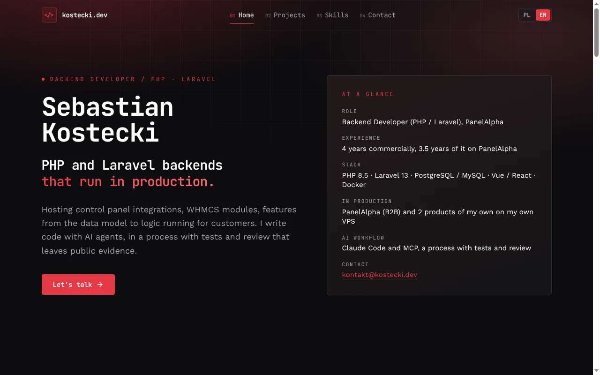

<div align="center">

# kostecki.dev

**Personal site and portfolio of Sebastian Kostecki — bilingual (Polish and English), dark monospace look, prerendered to static HTML.**

[](https://kostecki.dev)
[](https://github.com/sebastian-kostecki/kostecki-dev-landing/actions/workflows/build-site.yml)

[](https://vuejs.org/)
[](https://www.typescriptlang.org/)
[](https://vite.dev/)
[](https://tailwindcss.com/)
[](https://vitest.dev/)
[](https://pnpm.io/)
[](https://nginx.org/)

[Visit the site](https://kostecki.dev) · [Report an issue](https://github.com/sebastian-kostecki/kostecki-dev-landing/issues/new)

**English** · [Polski](README.pl.md)

</div>

<p align="center">
  <a href="https://kostecki.dev"></a>
</p>

## About

The site presents my work as a PHP and Laravel backend developer: experience on PanelAlpha, my own products running in production, how I work with AI agents and how to get in touch. Polish is the default language, English is one click away. Every route is prerendered to static HTML, so the site needs no Node.js on the server and reads well without JavaScript.

## Features

- **Bilingual content** — all copy lives in `src/content/pl.json` and `src/content/en.json`, typed by `src/types/content.ts`.
- **Prerendered pages** — a client build, an SSR build (`src/entry-server.ts`) and `scripts/prerender.mjs` write one HTML file per route plus `404.html`.
- **Values that stay fresh** — years of experience and similar values are computed from dates at build time and again in the browser.
- **Archive counter** — the number of archived changes across my public repositories is fetched at build time.
- **No third-party requests** — self-hosted fonts (`@fontsource-variable/*`) and icons collected at build time.
- **Hardened nginx** — HSTS, CSP and other security headers checked by a script.

## Tech stack

| Layer | Technology |
| --- | --- |
| App | Vue 3, TypeScript, vue-router, Vite 8, Tailwind CSS 4 |
| Quality | Vitest, oxlint, ESLint, vue-tsc |
| Hosting | nginx with `docker/nginx.conf`, served from a VPS |
| Delivery | GitHub Actions builds `dist/` and publishes it to the `site` branch |

## Getting started

### Prerequisites

- Node.js 20.19+ or 22.12+
- pnpm
- Docker, only for `pnpm check:nginx`

### Commands

```sh
pnpm install
pnpm dev               # generate archive counter, then Vite dev server
pnpm build             # generate icons + archive counter, type-check, client + SSR build, prerender
pnpm preview           # serve the built dist/ locally
pnpm test              # vitest run
pnpm lint              # oxlint + ESLint (with --fix)
pnpm type-check        # vue-tsc --build
pnpm check:nginx       # after pnpm build: nginx -t, HTTP statuses, security headers (needs Docker)
pnpm generate:icons    # rebuild src/generated/icons.json
```

## How it works

### Content

All copy lives in `src/content/pl.json` and `src/content/en.json`; the shape is defined in `src/types/content.ts`. Keep both files and the type in sync. Experience durations and similar values are computed from dates at runtime (and at build time for prerendered HTML), not stored as text.

### Prerender and deploy

`pnpm build` runs the client build, an SSR build and `scripts/prerender.mjs`, which writes static HTML per route into `dist/`. The build runs in GitHub Actions ([`build-site.yml`](.github/workflows/build-site.yml)) on every push to `master` and daily, and publishes `dist/` to the `site` branch. The VPS copies that branch into `www/`, which nginx serves. Because `dist/` contains one HTML file per route plus `404.html`, `docker/nginx.conf` must be deployed together with the build. Infrastructure lives in a separate, private repository.

Values derived from the date (years of experience, footer year) are frozen into the prerendered HTML and `llms.txt` at build time, so a rebuild refreshes them for crawlers without JavaScript; the browser recomputes them on load.

### Archive counter

`pnpm dev` and `pnpm build` first run `pnpm generate:archive`, which writes the gitignored `src/generated/archive.json`; on a fresh clone run it once before a standalone `pnpm type-check`. Without network it keeps the existing result or the tracked `src/generated/archive.fallback.json` and warns loudly. With `ARCHIVE_STRICT=1` it skips that fallback and exits 1 instead; the daily build runs in that mode, so a GitHub outage fails the run visibly and the site keeps its last published build.

### Icons

Icons are not fetched at runtime. `pnpm generate:icons` (`scripts/build-icons.mjs`, also run by `pnpm build`) collects the icons used by the site into `src/generated/icons.json`. Commit that file. Coverage is checked by `scripts/__tests__/icons.spec.ts`, so adding an icon without regenerating fails the tests.

### Fonts

JetBrains Mono and Work Sans are self-hosted through `@fontsource-variable/*` packages; there are no requests to Google Fonts.

### Security headers and CSP

`docker/nginx.conf` sets Strict-Transport-Security, X-Content-Type-Options, X-Frame-Options, Referrer-Policy, Permissions-Policy and a Content-Security-Policy. Rules:

- Any new external resource (script, font, image, API) requires a CSP change in `docker/nginx.conf`.
- Use `add_header` only at server level: an `add_header` inside a `location` block discards all inherited ones.
- `pnpm check:nginx` (`scripts/check-nginx.sh`) verifies the configuration.

## Documentation

- [`context/foundation/site-focus.md`](context/foundation/site-focus.md) — what the site is for and what it should emphasise
- [`context/site-audit-2026-11.md`](context/site-audit-2026-11.md) — site audit with findings and their status

## License

The code and the content are © Sebastian Kostecki, all rights reserved. Feel free to read the code for inspiration; please do not republish the content.
