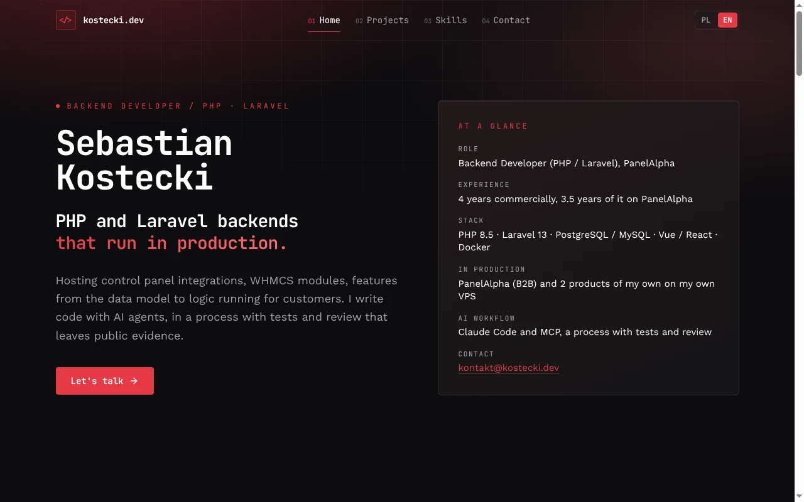

<div align="center">

# kostecki.dev

**Osobista strona i portfolio Sebastiana Kosteckiego — dwujęzyczna (polski i angielski), ciemna, w stylu monospace, prerenderowana do statycznego HTML.**

[](https://kostecki.dev)
[](https://github.com/sebastian-kostecki/kostecki-dev-landing/actions/workflows/build-site.yml)

[](https://vuejs.org/)
[](https://www.typescriptlang.org/)
[](https://vite.dev/)
[](https://tailwindcss.com/)
[](https://vitest.dev/)
[](https://pnpm.io/)
[](https://nginx.org/)

[Odwiedź stronę](https://kostecki.dev) · [Zgłoś problem](https://github.com/sebastian-kostecki/kostecki-dev-landing/issues/new)

[English](README.md) · **Polski**

</div>

<p align="center">
  <a href="https://kostecki.dev"></a>
</p>

## O projekcie

Strona pokazuje moją pracę jako backend developera PHP i Laravel: doświadczenie przy PanelAlpha, własne produkty działające na produkcji, sposób pracy z agentami AI i kontakt. Domyślnym językiem jest polski, angielski jest o jedno kliknięcie. Każda ścieżka jest prerenderowana do statycznego HTML, więc serwer nie potrzebuje Node.js, a strona czyta się dobrze bez JavaScriptu.

## Funkcje

- **Treść w dwóch językach** — cały tekst jest w `src/content/pl.json` i `src/content/en.json`, z typem w `src/types/content.ts`.
- **Strony prerenderowane** — build klienta, build SSR (`src/entry-server.ts`) i `scripts/prerender.mjs` zapisują jeden plik HTML na ścieżkę plus `404.html`.
- **Aktualne wartości** — lata doświadczenia i podobne wartości są liczone z dat przy buildzie i ponownie w przeglądarce.
- **Licznik archiwum** — liczba zarchiwizowanych zmian w moich publicznych repozytoriach pobierana jest przy buildzie.
- **Bez zapytań do firm trzecich** — fonty hostowane lokalnie (`@fontsource-variable/*`) i ikony zbierane przy buildzie.
- **Utwardzony nginx** — HSTS, CSP i inne nagłówki bezpieczeństwa sprawdzane skryptem.

## Stos technologiczny

| Warstwa | Technologia |
| --- | --- |
| Aplikacja | Vue 3, TypeScript, vue-router, Vite 8, Tailwind CSS 4 |
| Jakość | Vitest, oxlint, ESLint, vue-tsc |
| Hosting | nginx z `docker/nginx.conf`, serwowany z VPS |
| Dostarczanie | GitHub Actions buduje `dist/` i publikuje go na gałąź `site` |

## Uruchomienie

### Wymagania

- Node.js 20.19+ albo 22.12+
- pnpm
- Docker, tylko do `pnpm check:nginx`

### Polecenia

```sh
pnpm install
pnpm dev               # licznik archiwum, potem serwer deweloperski Vite
pnpm build             # ikony + licznik archiwum, sprawdzenie typów, build klienta i SSR, prerender
pnpm preview           # serwuje zbudowany dist/ lokalnie
pnpm test              # vitest run
pnpm lint              # oxlint + ESLint (z --fix)
pnpm type-check        # vue-tsc --build
pnpm check:nginx       # po pnpm build: nginx -t, statusy HTTP, nagłówki bezpieczeństwa (wymaga Dockera)
pnpm generate:icons    # przebudowuje src/generated/icons.json
```

## Jak to działa

### Treść

Cały tekst jest w `src/content/pl.json` i `src/content/en.json`; kształt opisuje `src/types/content.ts`. Oba pliki i typ trzymaj w zgodzie. Czas doświadczenia i podobne wartości liczone są z dat w przeglądarce (i przy buildzie dla prerenderowanego HTML), a nie zapisane jako tekst.

### Prerender i wdrożenie

`pnpm build` uruchamia build klienta, build SSR i `scripts/prerender.mjs`, który zapisuje statyczny HTML dla każdej ścieżki do `dist/`. Build działa w GitHub Actions ([`build-site.yml`](.github/workflows/build-site.yml)) na każdym pushu do `master` i codziennie, i publikuje `dist/` na gałąź `site`. VPS kopiuje tę gałąź do `www/`, które serwuje nginx. Ponieważ `dist/` ma osobny plik HTML na każdą ścieżkę plus `404.html`, `docker/nginx.conf` trzeba wdrażać razem z buildem. Infrastruktura jest w osobnym, prywatnym repozytorium.

Wartości zależne od daty (lata doświadczenia, rok w stopce) są zamrażane w prerenderowanym HTML i `llms.txt` przy buildzie, więc przebudowa odświeża je dla crawlerów bez JavaScriptu; przeglądarka przelicza je przy ładowaniu.

### Licznik archiwum

`pnpm dev` i `pnpm build` najpierw uruchamiają `pnpm generate:archive`, który zapisuje ignorowany przez git `src/generated/archive.json`; na świeżym klonie uruchom go raz przed samodzielnym `pnpm type-check`. Bez sieci zostawia istniejący wynik albo śledzony `src/generated/archive.fallback.json` i głośno ostrzega. Z `ARCHIVE_STRICT=1` pomija ten fallback i kończy się kodem 1; codzienny build działa w tym trybie, więc awaria GitHuba widocznie wywraca przebieg, a strona zostaje przy ostatnim opublikowanym buildzie.

### Ikony

Ikony nie są pobierane w przeglądarce. `pnpm generate:icons` (`scripts/build-icons.mjs`, uruchamiany też przez `pnpm build`) zbiera ikony używane przez stronę do `src/generated/icons.json`. Ten plik commituj. Pokrycie sprawdza `scripts/__tests__/icons.spec.ts`, więc dodanie ikony bez ponownego wygenerowania wywraca testy.

### Fonty

JetBrains Mono i Work Sans są hostowane lokalnie przez paczki `@fontsource-variable/*`; nie ma zapytań do Google Fonts.

### Nagłówki bezpieczeństwa i CSP

`docker/nginx.conf` ustawia Strict-Transport-Security, X-Content-Type-Options, X-Frame-Options, Referrer-Policy, Permissions-Policy i Content-Security-Policy. Zasady:

- Każdy nowy zewnętrzny zasób (skrypt, font, obraz, API) wymaga zmiany CSP w `docker/nginx.conf`.
- `add_header` tylko na poziomie `server`: `add_header` wewnątrz bloku `location` kasuje wszystkie odziedziczone nagłówki.
- `pnpm check:nginx` (`scripts/check-nginx.sh`) sprawdza konfigurację.

## Dokumentacja

- [`context/foundation/site-focus.md`](context/foundation/site-focus.md) — do czego służy strona i co ma podkreślać
- [`context/site-audit-2026-11.md`](context/site-audit-2026-11.md) — audyt strony z ustaleniami i ich statusem

## Licencja

Kod i treść © Sebastian Kostecki, wszelkie prawa zastrzeżone. Kod możesz czytać dla inspiracji; nie publikuj proszę treści ponownie.
